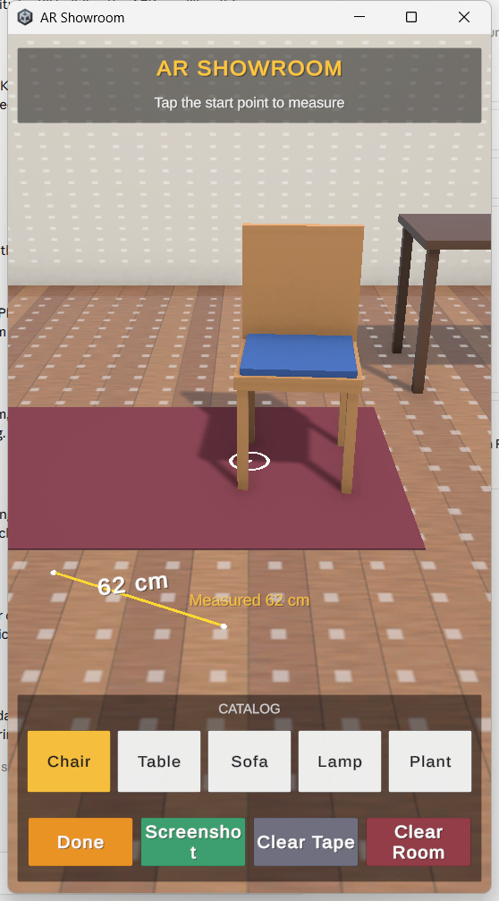
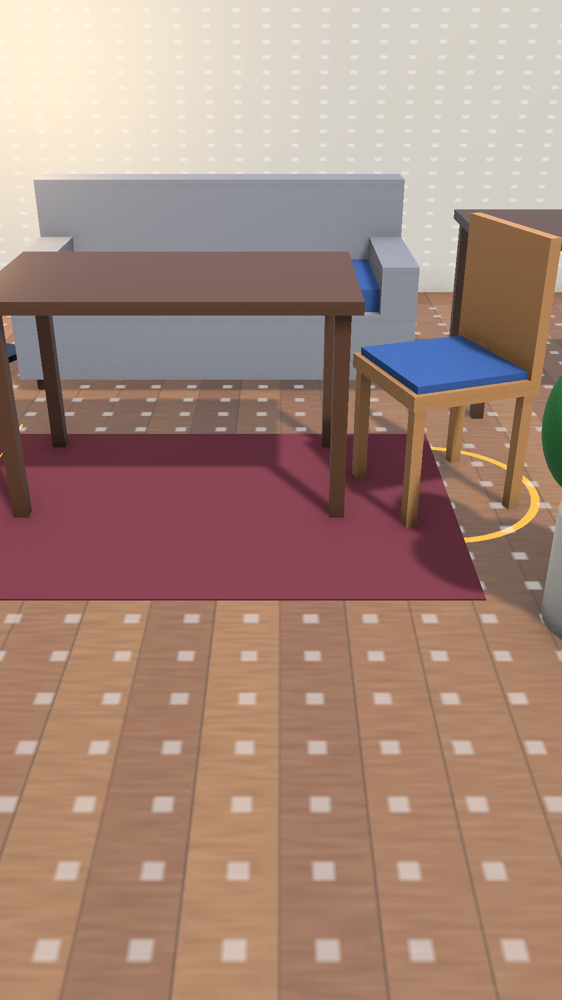

# AR Showroom (Android AR sample app)

A sample **Android** app built with Unity and **AR Foundation**: furnish your real room with virtual furniture,
measure distances with an AR tape measure and save screenshots.

 

## Features
- **Catalog** of real-size furniture: Chair, Table, Sofa, Floor Lamp (with light), Plant
- **Place** on the floor (tap), **move** (drag), **rotate** (two-finger twist or *Rotate 45*), **delete**
- Furniture faces you when placed and is refused on walls
- **AR tape measure**: tap a start point, see a live line to the reticle, tap the end point -> distance in cm / m
- **Photo** button saves a screenshot as PNG in the app's storage (`Android/data/com.college.arshowroom/files/`)
- **Onboarding** card until the first surface is found
- **ARCore support check**: unsupported phones get a message and a *Try Demo Mode* button (virtual room)
- Portrait UI, ARCore set to *Optional*, anchors on every placed item

## Controls
| Phone | Editor | Action |
|---|---|---|
| Tap floor | Left click | Place selected catalog item |
| Tap furniture | Left click | Select it |
| Drag | Left drag | Move |
| Two-finger twist | Q / E | Rotate |
| Measure button | - | Toggle the tape measure |

## Run it
**On an Android phone (ARCore):** install `Builds/Android/ARShowroom.apk` (enable *Install unknown apps*, or `adb install -r ARShowroom.apk`).
The phone needs [Google Play Services for AR](https://developers.google.com/ar/devices). Allow camera access, then move the phone slowly so it can detect surfaces.

**On a Windows PC (no phone, no Unity needed):** run `Builds/Windows/ARShowroom.exe`. It opens in a phone-shaped window
(resizable) and plays in the **simulated room**: left click = tap, left drag = drag, mouse wheel = pinch, Q / E = twist,
hold right mouse to look around, W A S D to move.

**In the Unity Editor (no phone needed):** open the project in Unity Hub (Unity **6000.4.0f1**), open `Assets/Scenes/ARShowroom.unity` and press **Play**.
Without an AR device the app switches to a **simulated room** so every interaction can be tried with mouse and keyboard:
hold **right mouse** to look around, **W A S D** to move, **R / F** up and down.

## Build
Menu **AR Showroom -> Build Android APK** or **Build Windows (PC)** (needs Android Build Support). The editor builder in `Assets/Scripts/Editor` generates the scene, prefabs and settings.

## Tests
**Window -> General -> Test Runner -> PlayMode -> Run All** (runs in the simulated room).

## Tech
Unity 6 (URP) - AR Foundation 6.6 - Google ARCore XR Plugin 6.6 - Input System (Enhanced Touch).
